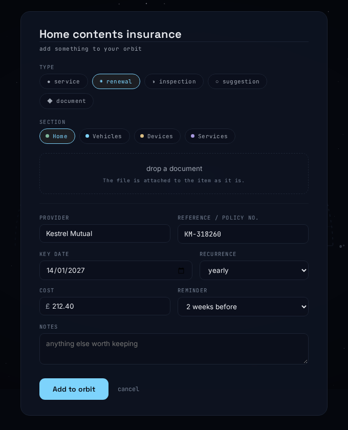

> [!IMPORTANT]
> **Development disclosure:** Orbit was coded by Claude under human
> direction.

<h3>
  <a href="https://tomlawesome.github.io/orbit-site/">Website</a>
  &nbsp;&nbsp;·&nbsp;&nbsp;
  <a href="https://github.com/tomlawesome/orbit/security/policy">Report a vulnerability</a>
  &nbsp;&nbsp;·&nbsp;&nbsp;
  <a href="https://github.com/tomlawesome/orbit/blob/main/LICENSE">Licence</a>
</h3>

  <strong>Everything in your orbit, on track.</strong> 
  A self-hosted home operations hub for maintenance, renewals, recurring
  services, contracts, cover, and the people who share them.

 

## What you can do with Orbit

A household can use Orbit to:

- keep a list of the things it looks after, as services, renewals,
  inspections, documents that expire, and ideas to come back to;
- give each one a due date and say how often it comes round;
- get reminders before an item is due, by default 14 days and 3 days ahead;
- keep a document beside the item it belongs to;
- share all of it with the other people in the household.

Orbit runs on your own server, so your household's records stay with you.

## Start here

- [Using Orbit](docs/using-orbit.md): the everyday guide, from joining a
  household to adding an item and setting when it is due.
- [Installing Orbit](docs/installing.md): what you need, the install command
  and what the installer does.
- [All the documentation](docs/README.md): the full index.
