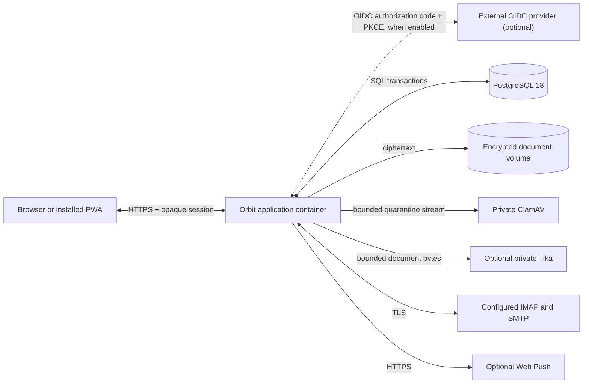

# Orbit architecture and operations baseline

## System context

Orbit is a modular full-stack application deployed as one container. The
browser never talks directly to PostgreSQL, document storage, ClamAV, Tika,
IMAP, SMTP, or Web Push providers.



The labelled diagram above shows what crosses each trust boundary. The
administrator view of the topology is in
[Installing Orbit](installing.md#what-runs-where). The supported topology and
deferred alternatives are recorded in
[ADR-0001](adr/0001-self-hosted-single-instance.md).

## Application boundaries

| Boundary | Responsibility | Current implementation |
| --- | --- | --- |
| API routes | HTTP parsing, session/CSRF enforcement, cache policy, response mapping | `web/src/routes/api` |
| Web front end | Every signed-in and signed-out screen | SvelteKit in `web/`, built from the ratified mockups; the Dockerfile builds it as the product's front end. See [ADR-0012](adr/0012-front-end-leaves-react.md) |
| Authentication | Local password credentials (always available) and optional OIDC discovery/callback, instance-claim validation, provisioning, sessions, recent-authentication step-up | `src/lib/auth`, `src/server/local-credentials.ts` |
| Domain and workspace | Item, schedule, section, notification and household command contracts | `src/lib`, `src/server/workspace-*` |
| Authorization | Instance, household, owner and document access decisions | `src/server/authorization.ts`, `workspace-access.ts`, document authorization |
| Persistence | Versioned Drizzle schema, migrations and transactional repositories | `src/db`, `drizzle`, repository modules |
| Documents | Validation, scanning, encryption, storage and reconciliation | `src/server/documents`, document repositories/workers |
| Integrations | OIDC, ClamAV, Tika, IMAP, SMTP and Web Push adapters | focused library/server modules |
| Mail-in | IMAP receipt intake, review-inbox state and failure reasons (#1143) | `src/server/mail-in`, see its own `README.md` |
| Operations | Health, safe administrator views, backup, restore and release scripts | administrator modules and `scripts` |

Routes remain thin. Business rules and authorization must live in reusable
server/domain boundaries so they can be integration-tested without a browser.

## Trust boundaries

1. **Unauthenticated network:** no household, document, archive, account, or
   operations metadata is disclosed.
2. **Authenticated browser:** input, rendered state, filenames, uploaded bytes,
   and identifiers remain untrusted. Client-side visibility is never
   authorization. Private workspace snapshots and commands are not retained in
   app-controlled durable browser storage.
3. **Household authorization:** access is rechecked server-side for every
   request and stream. Removed membership must take effect immediately.
4. **PostgreSQL:** the durable source for identities, permissions, lifecycle,
   jobs, audit events, and document metadata. Transactions do not encompass
   external network or filesystem side effects.
5. **Quarantine and processors:** plaintext documents are bounded, private,
   temporary, and treated as hostile regardless of format or source. Parser,
   metadata, and OCR output is bounded evidence, not an instruction, authority
   decision, or automatic write. The optional Tika parser runs on a dedicated
   internal network with no database, storage, secret, default-network, or
   outbound route. Its non-root read-only runtime disables OCR and embedded
   recursion; PDF/JPEG/PNG container validation and a clean ClamAV result are
   mandatory before parser entry.
6. **Encrypted storage:** durable document bytes are ciphertext addressed by
   opaque keys. The key-encryption key is a separately mounted runtime secret.
7. **External providers:** receive only the minimum data required by their
   adapter. Provider errors are reduced to bounded safe categories before
   persistence or display.
8. **Backups:** contain private database data and ciphertext, exclude plaintext
   secrets, and require separately protected recovery material.

The binding document controls remain in
[the document threat model](document-threat-model.md).

## Durable state and workers

Orbit uses explicit database lifecycle states for sessions, households,
documents, archives, notification deliveries, document jobs, and IMAP
receipts. Recurring work is coordinated through PostgreSQL leases or claims.

Worker invariants:

- a claim has an owner/token and expiry;
- completion checks the current claim and expected source state;
- retries are bounded and classified;
- externally visible side effects occur only after durable intent is recorded;
- irreversible filesystem work does not hold a database transaction open;
- reconciliation repairs or reports partial database/storage transitions;
- duplicate delivery risk that cannot be eliminated, such as SMTP acceptance
  followed by a lost database update, is explicit to administrators.

One piece of state is deliberately in memory, not in PostgreSQL: the archive
slot (#1316, `web/src/lib/server/archive-slot.js`). The archive import check or
import reads the upload in pieces and never holds it whole (#1566): the memory
test pins the import check's growth below the archive file's size, and a warmed process's
import below the archive file's size, since the document path holds one copy of each
document; the first import after start also pays a working set of about 50 MiB that glibc
keeps from the stream's freed chunks and later imports reuse (#1567). Before that it held about 1.45 GB (#1537).
A format v2 archive (#1390, ADR-0045) is sealed in 1 MiB segments that are each
authenticated, so the import verifies a segment at a time, never touches the
scratch tmpfs, and stages each document through the document path before one
transaction binds them all ("stage then switch"); its size is bounded by the
household quota and the disk, not by memory. Only a v1 archive still decrypts
into the scratch tmpfs sized for one archive. Every import restores its
documents through the document path, which is one at a time, and Orbit is one
process, so the process runs one archive at a time. The slot covers the
processing only, not the upload (#1792): a preview or import first writes its
archive file whole to a spool file on the document volume
(`<storageRoot>/portable-archives/<uuid>.upload.tmp`, checked against free
space first, removed however the request ends), and only then claims the slot,
so how long it is held is server time bounded by the file's size, never the
client's link speed. One upload per account may be spooling or processing at
a time; a second from the same account is answered 429 at once, while
different accounts spool side by side. A spooled request that finds the slot
held waits for it, first come first served, for up to 10 minutes
(`ORBIT_ARCHIVE_SLOT_WAIT_MS`), and is answered 429 if the wait runs out; an
export, whose body is small, is still answered 429 straight away when the slot
is held. The slot and the per-account lanes belong to the Node
process, which is correct for the supported deployment of one app container
running one process; two app containers, or a clustered process, would each
get their own slot and between them run that many archives at once. Two
imports of one household are still refused across processes: phase 0 answers
409 while another import's start record is open and live (ADR-0045 decision
5). The route takes the lane and the slot only after its household role check
(and an import's step-up), so someone who may not export or import that
household never holds either.

A streamed download hands its 1 MiB pieces to the HTTP response, which drops
them; V8 frees such pieces at a fixed external-memory trigger (about 33 MiB on
Node 22), so a serving process carries up to that much dead plaintext at any
moment, however many downloads are in flight and whatever their size (#1571).

## Core data flows

### Authenticated command

1. Route validates the opaque session, same origin, CSRF token, and input
   schema.
2. The service/repository verifies current instance and household authority.
3. One transaction validates the expected state, applies the mutation, and
   records the audit event.
4. The route returns non-cacheable state. The client refreshes from the server
   rather than treating optimistic state as authoritative for structural
   changes.
5. Failed browser commands are visible, are not queued or replayed, and leave
   the last server-confirmed workspace in memory.

### Document intake

1. Authorize the user, household, item, quota, and declared size.
2. Stream bounded plaintext into private quarantine while hashing and
   identifying content from bytes; the server holds one copy of the file for
   the open check, and encrypts it from the quarantine file in pieces,
   verifying its digest as it goes (#1567).
3. Scan the quarantine file with ClamAV first ([ADR-0033](adr/0033-document-safety-standard-patterns.md));
   explicit scan-disabled operation records `skipped` instead. Only on a clean
   or `skipped` result does the structure check read the quarantine file, once,
   and nothing opens the file before that. A file that passes is then encrypted
   from quarantine, streamed, with a per-document DEK before returning `201` and
   `available`.
4. Malware, invalid structure, and the scanner-reported `scanner` error are
   terminal fail-closed outcomes. Only adapter `unavailable`, `timeout`, and
   `protocol` errors encrypt the received bytes, not yet structure-checked,
   for the separate opaque `staging/` namespace, record a `scanning`/`error`
   document and PostgreSQL scan job, and return `202` with no-store headers.
5. A leased worker reclaims the staged object with generation/token fencing,
   re-scans it, checks its structure after a clean result, and atomically
   publishes ordinary ciphertext only once both pass. Stage expiry, malware, invalid staging, and purge failures
   remain inaccessible and are represented by bounded metadata.
6. Parse only through an optional private adapter after the document is
   available. Validate and bound any suggested fields, then require user
   review.

### Backup and restore

1. Produce a PostgreSQL custom-format dump, encrypted document tree (including
   `staging/` recovery ciphertext), and authenticated manifest in a private
   staged location; plaintext quarantine is never included.
2. Verify the bundle before publication.
3. Before active replacement, restore into disposable staged state and validate
   key identity plus exact database/blob correspondence.
4. Create a verified durable checkpoint and restore journal, then perform a
   stopped-application cutover with PostgreSQL single-transaction restore.
5. Recheck correspondence, restart and verify application health. Ordinary
   failure restores the checkpoint; hard interruption requires explicit
   recovery from the preserved journal and checkpoint.

Never generate or overwrite a KEK implicitly. The rollback boundary and
recoverable restore protocol are binding in
[ADR-0004](adr/0004-supported-upgrades-and-recoverable-restore.md).
If checkpoint restoration fails, keep Orbit stopped and preserve the recovery
evidence rather than starting with unproven mixed state.

## Operations baseline

| Area | Current control | Principal v1 gap |
| --- | --- | --- |
| Installation | Idempotent configuration scripts and file-backed secrets | Prove clean install on the supported host and document failure recovery |
| Migrations | Ordered migrations in `drizzle/`, optional migrate-on-start | Add fresh-schema and representative upgrade-path CI |
| Health | Application and service health checks; administrator summaries | Exercise degraded optional providers and safe diagnostics |
| Workers | PostgreSQL-backed state, retries and several lease boundaries | Integration-test concurrent claims, stale workers and restart recovery |
| Backup/restore | Automated database plus encrypted-file round trip | Implement and prove staged correspondence, durable rollback checkpoints, corrupt/wrong-key cases and interrupted recovery |
| Logging/audit | Bounded categories and audit tables | Verify redaction and event completeness across critical flows |
| Release | Static/unit issue lanes into `dev`, one build-once exact-image publication from protected `preview`, automatic train versions, digest-bound attestations, exact-source verification and guarded no-rebuild promotion to `latest` plus a GitHub Release | Exercise representative preview acceptance plus stable promotion |
| Rollback | Prior image and verified pre-update backup retained; no unproven database downgrade | Prove the ADR-0004 update and recovery decision points |

## Architecture decisions and open questions

Durable decisions live in `docs/adr`; issues track their implementation.

- [ADR-0001: Self-hosted single-instance deployment](adr/0001-self-hosted-single-instance.md)
- [ADR-0002: Evidence-driven delivery and immutable promotion](adr/0002-evidence-driven-delivery.md)
- [ADR-0003: Protected preview lane and stable promotion](adr/0003-gitflow-preview-and-stable-channels.md)
- [ADR-0004: Supported upgrades and recoverable restore](adr/0004-supported-upgrades-and-recoverable-restore.md)
- [ADR-0005: Private reviewed ingestion and mailbox staging](adr/0005-reviewed-ingestion-and-mailbox-staging.md)
- [ADR-0006: Online-authoritative private workspace](adr/0006-online-authoritative-private-workspace.md)
- [ADR-0010: Outage-recoverable document scanning](adr/0010-outage-recoverable-document-scanning.md)

Decisions intentionally deferred beyond stable v1 include managed multi-tenancy,
object storage, horizontal workers, a remote semantic-extraction provider, and
automatic model-written household data. Their absence must not complicate the
supported v1 topology.

## Authentication internals

These two sections moved here from [Authentication](authentication.md). They
are for people working on Orbit, not for running it.

### Application endpoints

| Method | Endpoint | Purpose |
| --- | --- | --- |
| `GET` | `/api/auth/availability` | Signed-out: whether the instance is claimed, which sign-in methods are offered, and whether password sign-ins are approved by email. Reveals nothing about accounts. |
| `POST` | `/api/auth/bootstrap/claim` | Verifies the claim code and sets a short-lived claim cookie. |
| `POST` | `/api/auth/bootstrap/local` | Creates the first administrator with a password, under the claim cookie. |
| `POST` | `/api/auth/local/login` | Checks email and password. Answers with a pending sign-in (and mails its approval link) unless the instance has no mail relay, in which case it signs the user in directly. |
| `POST` | `/api/auth/local/login/pending` | The waiting tab asks whether its sign-in has been approved; mints the session for that browser when it has. Authorised by the pending-sign-in cookie alone. |
| `POST` | `/api/auth/local/login/resend` | Sends the approval link again, inside the send limits. Same cookie, same rule. |
| `POST` | `/api/auth/approve` | Records **Approve** or **This wasn't me** for a pending sign-in. Signed out, and signs nobody in. |
| `GET` | `/api/auth/sign-in-notice` | The one line a refused sign-in left for its owner. Asking for it spends it. |
| `GET` | `/api/auth/login?returnTo=/path` | Starts OIDC sign-in and redirects to the provider (`auth_not_configured` when OIDC is off). |
| `GET` | `/api/auth/callback` | Validates the provider response and completes sign-in, bootstrap, linking, or step-up, depending on what started the transaction. |
| `GET` | `/api/auth/session` | Returns the current user, expiry, household context, and CSRF token. |
| `POST` | `/api/auth/logout` | Ends the local session, then redirects to the provider's end-session page with `id_token_hint` when the session came from the provider. |
| `POST` | `/api/auth/sessions/revoke` | Ends every session the caller holds, including the calling device, and clears its cookie (see [Signing out, plainly](authentication.md#signing-out-plainly)). |
| `GET` | `/api/auth/methods` | The caller's own sign-in methods: password set/changed, and linked providers. |
| `POST` | `/api/auth/local/password` | Sets or changes the caller's password, behind recent authentication. |
| `POST` | `/api/auth/local/setup` | Consumes a setup or recovery token, sets a password, and signs the user in. |
| `POST` | `/api/auth/link/oidc/start` | Starts linking an OIDC identity to the signed-in account, behind recent authentication. |
| `POST` | `/api/auth/step-up/start` | Starts a step-up re-challenge with the provider for an OIDC-only user. |
| `DELETE` | `/api/auth/methods/local`, `/api/auth/methods/oidc/:identityId` | Removes a sign-in method, refused if it is the last one. |
| `POST` | `/api/admin/users` | Administrator: creates a local user and emails the setup link. |
| `POST` | `/api/admin/users/:userId/setup-link` | Administrator: re-issues and re-sends a setup or recovery link. |
| `GET` | `/api/workspace` | Returns the caller&apos;s authorized households and records. |
| `POST` | `/api/workspace/commands` | Applies one validated, authorized workspace mutation. |
| `PUT` | `/api/preferences` | Saves the caller&apos;s appearance preferences. |
| `GET/PUT` | `/api/settings/reminders` | Reads or saves the caller&apos;s own reminder timing and reports the instance&apos;s outbound-mail state. |
| `GET/POST/DELETE` | `/api/households/:id/members` | Lists or changes direct household membership. |
| `POST/DELETE` | `/api/push/subscriptions` | Registers or revokes the caller&apos;s browser push subscription. |

The `returnTo` parameter accepts application-relative paths only. Authentication and session responses are explicitly non-cacheable.

To call a state-changing endpoint, first request `/api/auth/session`, then send its `csrfToken` in the `X-CSRF-Token` header. The browser also sends the HTTP-only session cookie automatically:

```ts
const sessionResponse = await fetch("/api/auth/session", { cache: "no-store" });
const session = await sessionResponse.json();

await fetch("/api/auth/logout", {
  method: "POST",
  headers: { "X-CSRF-Token": session.csrfToken },
});
```

### Security model

The first paragraph of the security model stays in
[Authentication](authentication.md#security-model). The detail behind it follows.

- Local passwords are hashed with Argon2id and verified through an in-process
  concurrency gate so a burst of sign-in attempts cannot exhaust the host;
  failures are timed alike whether the email is unknown, the password is
  wrong, or the account has no credential, so none of the three is
  distinguishable from outside. Failed attempts are backed off per credential
  (five free attempts, then a doubling lockout up to 15 minutes) and the
  counter is a database row, so a restart does not reset it.
- OIDC sign-in uses random state, nonce, and a 256-bit PKCE verifier. The
  short-lived login transaction is authenticated and encrypted in an
  HTTP-only, same-site cookie.
- Discovery metadata must exactly match the configured HTTPS issuer. Provider endpoints must also use HTTPS.
- ID-token signature, issuer, audience, expiry, nonce, authorized party, and access-token hash are validated where applicable.
- Provider access and refresh tokens — anything that could call another service — are never stored. The ID token from a provider sign-in is kept on that session's row, encrypted under the instance's encryption key (the one that protects account addresses), so that signing out can tell the provider which session to end. It is deleted with the session, is handed to the browser once, inside the provider sign-out address at the moment of sign-out, and never on any session read or list, and cannot be used to sign in to Orbit again.
- The browser receives a random opaque session credential. Only its SHA-256 hash is stored in PostgreSQL. Setup and recovery tokens are stored the same way: only their SHA-256 hash, never the token itself.
- Logout deletes the session credential server-side and expires the cookie.
- State-changing session actions require an exact same-origin request and a session-bound HMAC synchronizer token.
- Production cookies use `Secure`, `HttpOnly`, `SameSite=Lax`, and the `__Host-`/`__Secure-` prefixes where their path constraints permit.
- Every password sign-in is completed by a link emailed to the account
  (ADR-0027). The link and the waiting tab's claim are separate 32-byte
  secrets, stored only as SHA-256 hashes, and each is spent once: the link
  decides whether the sign-in is allowed, the claim decides which browser may
  collect the session. Ten minutes, one live link per pending sign-in, and the
  approval page changes nothing until a button is pressed.
- Local users are enumerable by nobody outside the administrator user list:
  every sign-in failure is one word, one status, one cost, regardless of
  which of the three causes produced it.
