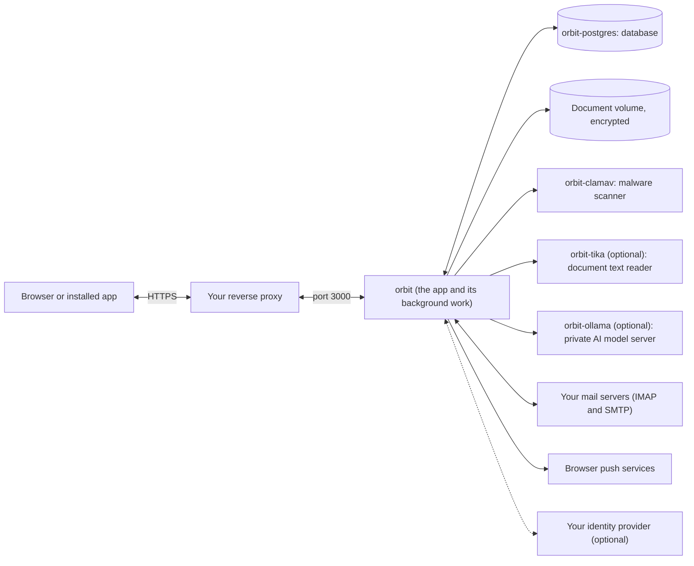

# Installing Orbit

How to install Orbit on a Linux machine, what the installer asks, and what
it sets up. Once it is running, [Running Orbit](operating.md) covers looking
after it, and [Upgrades and backups](upgrades-and-backups.md) covers updating
and backing up. [The installer's guarantees](installer-guarantees.md) list exactly
what each script promises.

## What you need

- A Linux machine with 64-bit x86 processors (amd64). Orbit's builds are
  made for amd64 only for now. The launcher itself also runs on arm64, but
  Orbit will not.
- Docker with Compose v2.
- `curl`, `openssl`, `tar`, `sha256sum` and `base64`, which most Linux
  systems already have.
- An HTTPS address for Orbit, served by a reverse proxy on that machine or
  in front of it.
- About 4 GiB of free memory for the malware scanner, on top of Orbit and
  its database.

Your reverse proxy must accept uploads a little larger than Orbit's document
limit. The limit is 50 MiB by default, and an administrator can change it
(up to 100 MiB) with the upload size limit in Administration. Many proxies
refuse much smaller requests unless told otherwise, and a document over the
proxy's own limit fails with "413" before it reaches Orbit. Set the proxy a
little above the limit your administrator chooses: 51 MiB for the default,
or 101 MiB to cover every possible setting.

Bringing a household in from an Orbit archive that includes documents sends
a larger request, up to 343 MiB. If you will import archives, set the proxy
to 343 MiB instead; it covers every document setting too.

- nginx: `client_max_body_size 51m;` (or `101m;`, or `343m;`). Its default
  is 1 MB, so this setting is needed.
- Caddy: limits request bodies only if you set
  `request_body { max_size 51MiB }` (or `101MiB`, or `343MiB`).
- Traefik: limits request bodies only if the buffering middleware sets
  `maxRequestBodyBytes` (53477376 is 51 MiB; 105906176 is 101 MiB;
  359661568 is 343 MiB).

If the document limit is raised later, raise the proxy setting to match.

Orbit sends its own Content-Security-Policy with every page, which tells the
browser where a page may load scripts, images and other content from. If your
proxy also sends one, the browser enforces both, and every page goes blank
unless the proxy's policy allows everything Orbit's does. That includes inline
scripts Orbit marks with a fresh nonce on each page, which a proxy cannot list
in advance. So the simplest rule is: send no policy of your own, or one with no
`script-src` (and no `default-src`) restriction. Do not make the proxy remove
Orbit's header.

Orbit also refuses to be shown inside another site's frame: every response
carries `X-Frame-Options: DENY`, and the policy on every page the server draws
says `frame-ancestors 'none'`. The three sign-in pages built ahead of time
(`/login`, `/logout`, `/auth/error`) carry their policy in the page itself,
where `frame-ancestors` has no effect, so the `X-Frame-Options` header covers
them. A proxy need not add either.

## What runs where

Orbit runs as a few Docker containers on one machine. Your browser talks only
to the Orbit container, usually through your reverse proxy. The database and
the other helpers cannot be reached from the browser.



| Container | What it does | When it runs |
| --- | --- | --- |
| `orbit` | Orbit itself: the web app, plus the background work that sends reminders, processes documents and collects mail. | Always. |
| `orbit-postgres` | The database (PostgreSQL 18). | Always. |
| `orbit-clamav` | The malware scanner. Uploads are scanned before they are kept. | Always. |
| `orbit-tika` | Reads the text in documents so Orbit can suggest an item's details. | Only with the Document processing or Full local stack profile. |
| `orbit-ollama` | A private AI model server on your own machine. | Only with the Full local stack profile, or Custom, Local Ollama infrastructure only. |

Things worth knowing:

- Orbit listens on port `3000` by default. `ORBIT_PORT` changes the port and
  `ORBIT_BIND_ADDRESS` chooses which network address it listens on; see
  [Open Orbit](operating.md#open-orbit).
- Your documents are kept encrypted in one Docker volume, and the database is
  in another. A backup covers both:
  see [Upgrades and backups](upgrades-and-backups.md).
- The scanner, the text reader and the model server share a private network
  with Orbit. Of the three, only the scanner has a separate connection out,
  which it uses to update its malware signatures. None of them can reach
  the database.
- Orbit itself connects out to the mail servers you set up, to browser push
  services when people turn on alerts, and to your identity provider if you
  use one.

## Install

From an empty directory, run:

```bash
curl -fsSL https://raw.githubusercontent.com/tomlawesome/orbit/main/scripts/get-orbit.sh | bash
```

This one line downloads and checks the signed Orbit launcher before it runs
anything:

- it checks the release's signed manifest (the list of files that make up
  the release) against Orbit's public key;
- if `cosign` is installed, it also checks a second, independent signature,
  and refuses if that signature is missing;
- it checks every file it downloads against the checksum in the manifest.

Only once everything checks out does it start the launcher, which runs the
installer described below. It installs the newest stable release. To install
one particular release instead, put `ORBIT_VERSION=v0.3.0` (or another
version) in front of `bash`. [Installer guarantees](installer-guarantees.md)
says exactly what is checked (its `get-orbit.sh` section), and [Releasing](releasing.md) says how the
signatures are made.

Git is not needed and nothing is cloned. A deployment needs only the Compose
files, a few operator scripts and a published build of Orbit, not the source
code.

### What the installer asks

The installer shows a menu: Install, Update, Repair or Exit.

- **Install** sets up a new Orbit in an empty directory. It first asks which
  profile you want: Standard (Orbit, its database and the malware scanner),
  Document processing (adds a local document text reader), Full local stack
  (adds a private AI model server as well), or Custom. It then asks whether
  people will sign in with Orbit's own accounts only (the default) or also
  through an identity provider, an external sign-in service such as
  Authentik. With Orbit's own accounts, it needs only Orbit's public address.
  With an identity provider, it also needs the provider's address (the
  "issuer"), the client ID the provider gave you, and the client secret,
  which you type hidden. Nothing in the directory changes until you accept
  the final review screen.
- **Update** moves an existing Orbit to the new release. If the current
  settings are complete, it keeps them and your secrets as they are and does
  not ask for them again. From a terminal, it asks whether to keep the
  current profile, then shows a review screen before it changes anything. Back up first: see
  [Upgrades and backups](upgrades-and-backups.md#update).
- **Repair** changes nothing. It tells you to run
  `bash scripts/repair.sh --check` to find what is wrong, then `--plan` to
  see what a repair would do.

When everything is running, the last screen shows Orbit's address, the
version, the exact build installed, the profile, and the commands for status
and logs. It then tells you two things to do next:

- Claim the new Orbit: the link that creates its first administrator is printed
  in the Orbit container's log. See
  [Claiming a fresh install](authentication.md#claiming-a-fresh-install).
- Export a recovery bundle, the only way back in if the document encryption
  key is ever lost. See
  [Exporting a recovery bundle](administrator-operations.md#exporting-a-recovery-bundle).

### What gets installed

The installer downloads Orbit from the release registry and records exactly
which build it downloaded, using the build's digest: a fingerprint that
identifies one build and nothing else. That fingerprint is written to
`.env-orbit`, and that build is what runs, so nothing can swap in a
different build behind your back.

The Compose files and operator scripts come out of that same build, so they
always match the version they came with. The directory ends up holding
`docker-compose.yml`, the extra Compose files `docker-compose.mail.yml`,
`docker-compose.kek-rotation.yml` and `docker-compose.no-document-key.yml`,
`.env-orbit.example`, `config/tika-config.json`, the scripts `configure.sh`,
`backup.sh`, `restore.sh`, `repair.sh`, `export-recovery-bundle.sh`,
`import-recovery-bundle.sh`, `end-maintenance.sh` and `installer-ui.sh`, your
settings in `.env-orbit`, and your secrets in `.orbit-secrets/`.

The installer itself only fetches, checks and starts things. Everything that
reads or writes the directory — checking it is safe to install into, asking
your questions, writing the settings and secrets, and checking your sign-in
provider — runs inside that same build, in a short-lived container that is
removed when it finishes. If anything goes wrong before Orbit starts, it puts
the directory back exactly as it was.

The installer then generates four separate secrets: one for sign-in
sessions, the database password, the document encryption key, and the
private key for browser alerts. They live in `.orbit-secrets/`, readable only by
the user who ran the installer. Each container is given only the secret
files it needs; secret values never go into container environment
variables. Later runs keep the secrets you already have.

It reports success only once the database is healthy, Orbit's own health
check at `/api/health` says ready, the malware scanner is healthy, and each
optional service you chose answers its check.

If you cancel during the questions, or a run finds a setting that needs
attention, the installer puts its files back as they were and prints only
the names of the settings and what to do next. Run the install line again,
or fix the settings directly from the deployment directory:

```sh
bash scripts/configure.sh --init
bash scripts/configure.sh --set-oidc-secret
bash scripts/configure.sh --check
```

These commands run inside the Orbit image, so Docker must be running and
the image must be available, even for a one-line change. `configure.sh`
takes the image from `ORBIT_IMAGE` in your environment, or else from the
`ORBIT_IMAGE=` line the installer wrote to `.env-orbit`. If it finds neither
it stops with:

```text
Orbit configuration: No Orbit image to run configuration with. Set ORBIT_IMAGE to an immutable registry digest (or the local tag scripts/build-container.sh builds), or install with get-orbit.sh, which records it in .env-orbit.
```

To go on, set `ORBIT_IMAGE` to the build's registry digest and run the
command again. A digest that is not on this machine yet is pulled first.
Files `configure.sh` creates belong to the user who ran it.

### If an install fails

When a new install fails after it has started writing files, the installer
puts the directory back as it found it and removes the containers and
volumes it created. It deletes only the files it wrote itself: anything else
new in the directory, such as a note you saved there while it ran, is moved
into `orbit-install-backups/<date and time>/moved/`, and the installer
prints where. One exception: `.env-orbit` and `.orbit-secrets/` are
put back whole from the copy taken at the start, so an edit or a file added
inside them while the install ran is replaced, and the closing line says so
when the rollback finishes.
If it could not stop the containers, it keeps the files it wrote in that
dated folder's `engine/` instead, and prints one command to stop them; run
it, then install again.

`orbit-install-backups/` is not a backup of your Orbit data (that is what
`scripts/backup.sh` makes). It is readable only by you; the installer never
reads, runs, moves or deletes anything in a folder from an earlier run, and
later installs ignore it. A run removes only its own copy of your original
files once they are put back, and its own dated folder when that leaves it
empty. You can leave it there.

### If an update stops

An update that stops after it has written its files is not undone: run the
update again and it carries on from there. If it stopped before the
containers were replaced and was made by an installer older than this
release, the next run may refuse because the running build differs from
`ORBIT_IMAGE`. Then start the deployment again from its folder, and run the
update again.

## Logged and unattended runs

The options in this section belong to `install.sh`, the installer script
the launcher runs for you. Running `install.sh` on its own is not a
supported way to install (see [Releasing](releasing.md)); the options are
listed for automated and test runs. Add `--plain` for output with no screen drawing, one line at
a time, safe for logs and pipes. Name the action with `--install`,
`--update` or `--repair`; with none, it installs into an empty directory and
updates a directory that already holds Orbit. `--install` accepts only an
empty directory (or a prepared one, below); `--update` accepts only a
directory that already holds Orbit.

`--simulate` (with `--plain` if you like) is a rehearsal. It shows the same
menus, questions and example success and failure screens, using clearly
labelled made-up values. It does not read or change the directory, and it
never contacts Docker, a registry or an identity provider. It cannot be
combined with `--install`, `--update` or `--repair`.

### Installing with no questions

For an unattended install, the directory must already hold a complete
`.env-orbit` and, optionally, an `.orbit-secrets/` directory, and nothing
else. Before it downloads anything, the installer checks that:

- `.env-orbit` is a plain file (not a symlink) with permissions `0600`;
- `.orbit-secrets/`, if it is there, is a real directory (not a symlink)
  with permissions `0700`, and every file inside it is a plain, non-empty
  file with permissions `0600`;
- if `.env-orbit` sets `ORBIT_AUTH_OIDC=true` (people sign in through an
  identity provider), `.orbit-secrets/oidc-client-secret` exists. With
  Orbit's own accounts only, `.env-orbit` on its own is enough: the
  installer creates `.orbit-secrets/` and generates the other secrets.
  The exception is an `.env-orbit` that still names
  `OIDC_CLIENT_SECRET_FILE` (kept when SSO is switched off): then the
  secret file must be there too, or the install stops and changes nothing;
- `.env-orbit` passes `bash scripts/configure.sh --check`.

Anything else is refused before Docker or any download starts: extra files,
symlinks, empty files, looser permissions, a setting that still needs
attention, an invalid callback address, or an optional group of settings
that is only half filled in. If the configuration check, the identity
provider lookup or the Compose check then fails, your files are left exactly
as they were.
