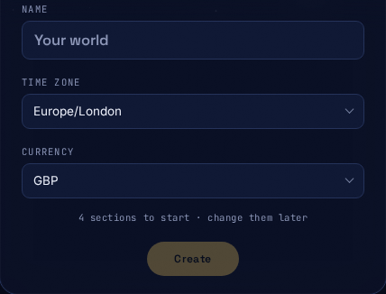

# Running Orbit

How to look after an Orbit once it is installed: opening it, starting and
stopping it, changing its settings, the optional document services,
and where to find updates and backups. Run every command on this page from the deployment
directory, the one you installed into. [Installing Orbit](installing.md#what-gets-installed)
lists what that directory holds.

## Open Orbit

Open the address in `APP_URL`. For a real deployment that is an HTTPS
address, and your reverse proxy must pass it on to Orbit's port, `3000` by
default (`ORBIT_PORT`). Plain HTTP works only on the machine itself, at
`http://127.0.0.1:3000`. Orbit's health check is at `/api/health`.

By default Orbit listens on every network interface of the machine. Set
`ORBIT_BIND_ADDRESS=127.0.0.1` in `.env-orbit` when only the machine itself,
or a reverse proxy running on it, should reach Orbit. Never open port `3000`
directly to the internet.

> [!IMPORTANT]
> Use one address everywhere: `APP_URL`, the address in the browser, and the
> callback address registered with an identity provider. Do not switch
> between `localhost` and `127.0.0.1` part-way through a sign-in.

## Claim it and create your household

Nobody sees a household without signing in. A new Orbit stays unclaimed
until someone opens the claim link Orbit prints in its log:

```sh
docker compose --env-file .env-orbit logs orbit-app
```

That person becomes the first instance administrator.
[Claiming a fresh install](authentication.md#claiming-a-fresh-install) has
the detail, including who else could read that link.

Next, Orbit shows the "where do you belong?" card. On a new install there is
nothing to ask to join, so the card's "name your own system" drawer is already
open. (If other households exist, they are listed with "ask to join", and you
open the drawer with "name your own system".) The drawer asks for three things
to create the first household: its name, its time zone and its currency. It
starts every household with four sections, Home, Vehicles, Devices and
Services, which you can rename, reorder, recolour or add to later on the
household screen.



Instance administrators can see every household and add any person to any
household. The People card in Administration shows each person as "admin" or
"user", but it has no control yet to give or remove administrator access
(issue #1633).

## Start, stop and check on it

```sh
docker compose --env-file .env-orbit ps
docker compose --env-file .env-orbit logs --tail 200
docker compose --env-file .env-orbit up -d
docker compose --env-file .env-orbit stop
```

The first two show what is running and its recent log, and are the commands
the installer prints at the end. `up -d` starts everything in the
background, and `stop` stops it without removing anything. Keep using
`--env-file .env-orbit` from the deployment directory, with no
`--project-name`, so every command finds the same containers and data.

On start, Orbit waits for its database, applies any pending database updates
(migrations), starts its reminder scheduler, then opens for visitors.

## Change the settings

Every setting lives in `.env-orbit` and is listed in
[Configuration](administrator-operations.md#configuration). After an edit,
check the file, then start Orbit again so it reads the change:

```sh
bash scripts/configure.sh --check
docker compose --env-file .env-orbit up -d
```

`--check` prints each setting's name and whether it is ready, never its
value. Three more commands help:

- `bash scripts/configure.sh --init` sets or changes how people sign in:
  Orbit's own accounts only, or an identity provider as well. It asks for
  Orbit's web address, which of the two you want and, for a provider, its
  issuer address and client ID. The provider's client secret is stored
  with the next command.
- `bash scripts/configure.sh --set-oidc-secret` stores the identity
  provider's client secret, typed hidden, in `.orbit-secrets/`.
- `bash scripts/configure.sh` on its own fills in any setting or secret that
  is missing and leaves the rest alone.

All of these run inside the Orbit image: `configure.sh` starts a short-lived
container from it, with no network, and that container reads and writes the
files. Docker must therefore be running and the image must be available,
even to change one setting. The image comes from `ORBIT_IMAGE` in your
environment, or else from the `ORBIT_IMAGE=` line in `.env-orbit`, which the
installer writes. With neither, it stops with:

```text
Orbit configuration: No Orbit image to run configuration with. Set ORBIT_IMAGE to an immutable registry digest (or the local tag scripts/build-container.sh builds), or install with get-orbit.sh, which records it in .env-orbit.
```

Set `ORBIT_IMAGE` to the build's registry digest (on a source checkout, the
local tag `scripts/build-container.sh` builds) and run it again. A digest
that is not on this machine is pulled first; a local tag that is not on this
machine is refused, because there is nothing to pull. Files it creates belong
to the user who ran it.

[Deployment configuration readiness](administrator-operations.md#deployment-configuration-readiness)
explains each of these in full, and [Authentication](authentication.md)
covers identity providers.

## Optional document services

The standard set-up already checks every upload for malware. Two more
services are optional, because they need a lot of memory and Orbit works
without them:

- **Apache Tika**, a document text reader. With it, Orbit reads the text
  of uploaded and forwarded documents so it can suggest an item's details.
  It does not read text out of scanned images: that feature (OCR) is
  switched off.
- **Ollama**, a private AI model server. With a model chosen, Orbit also
  asks the model to suggest a document's provider, reference, type, cost, how
  often it recurs and its dates, and checks the answer against its own
  rules. Either way, nothing is added until you review it.

To turn both on, add these lines to `.env-orbit`:

```sh
TIKA_URL=http://orbit-tika:9998
# Choose a local model only after checking its size, licence and memory needs.
OLLAMA_MODEL=<a-local-model-name>
COMPOSE_PROFILES=processing,ai
```

`processing` turns on Tika and `ai` turns on Ollama; leave
`COMPOSE_PROFILES` empty to run neither. Then start Orbit as usual with
`docker compose --env-file .env-orbit up -d`.

To turn them off again, empty `COMPOSE_PROFILES`, then stop and remove the
two containers. Downloaded models stay in their volume:

```sh
docker compose --env-file .env-orbit --profile processing --profile ai \
  rm --stop --force orbit-tika orbit-ollama
```

Neither service can be reached from outside the machine, and neither can
reach the internet or the database. Ollama is limited to 2 CPUs and 6 GiB
of memory by default, and Tika to 1 GiB.

Because Ollama cannot reach the internet, it cannot download a model
itself. Set `OLLAMA_MODEL` first, then run the one-off helper, which
downloads the model and exits:

```sh
docker compose --env-file .env-orbit --profile ai-model-pull \
  run --rm orbit-ollama-model-pull
```

[Private model server and its model pull](administrator-operations.md#private-model-server-and-its-model-pull)
has the detail, including machines with no internet access.

## Before the first real use

1. Open Orbit at its HTTPS address and sign in, with Orbit's own accounts or
   your identity provider.
2. Set up email. Password sign-ins are approved by an emailed link (see
   [Authentication](authentication.md#every-password-sign-in-is-approved-by-email)),
   and reminders go by email too. The administration screen's
   [provider tests](administrator-operations.md#provider-tests) check the
   connection.
3. Schedule `bash scripts/backup.sh`, keep copies off this machine, and try
   a restore. [Upgrades and backups](upgrades-and-backups.md) shows how to back
   up, check and restore.
4. Export a recovery bundle and store it, and its passphrase, away from this
   machine.
5. Read [Encryption at rest](encryption-at-rest.md) and decide whether the
   machine's disk needs encrypting. Orbit does not decide this for you.
6. Leave room on the document disk for page pictures. Orbit draws every page
   of every document once and keeps the picture, encrypted, so turning a page
   is quick (#1433). Allow about 200 KB a page: about 600 MB for 1,000
   three-page documents, at most about 20 MB for one 100-page document. The
   pictures do not count against any quota. After an upgrade, existing
   documents are drawn slowly in the background, at low priority.
