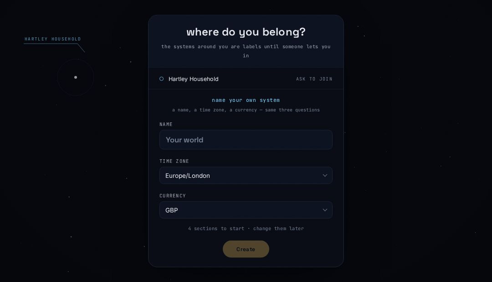
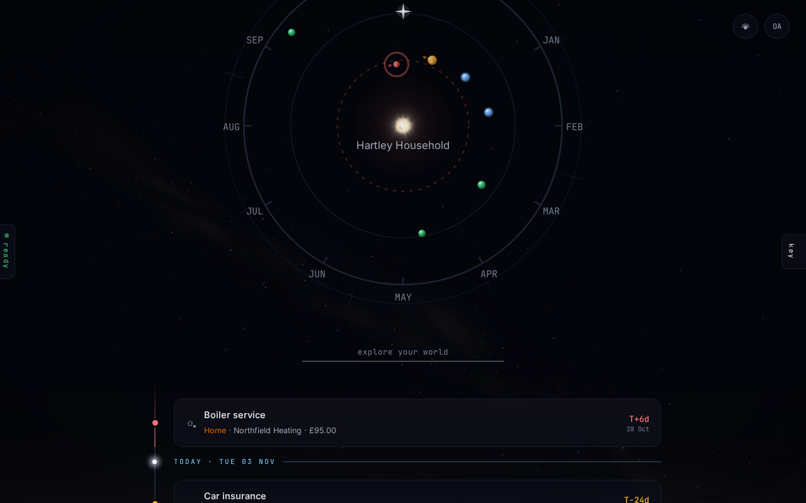
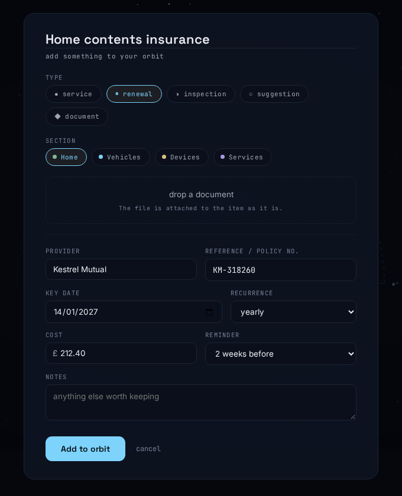
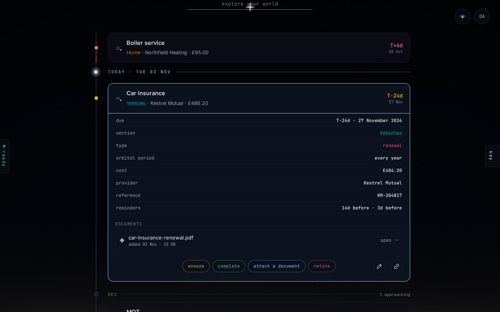
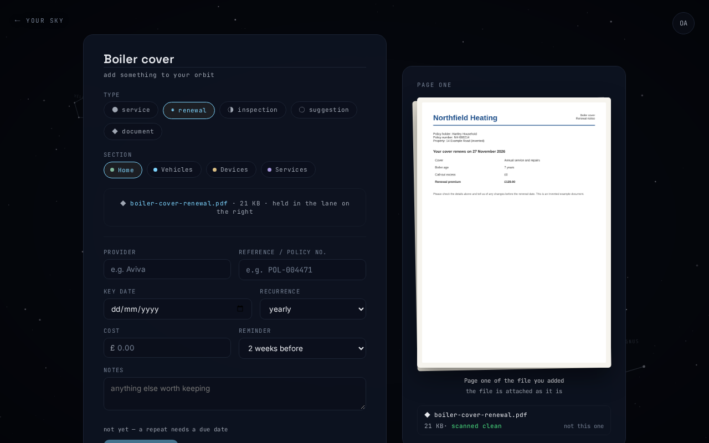
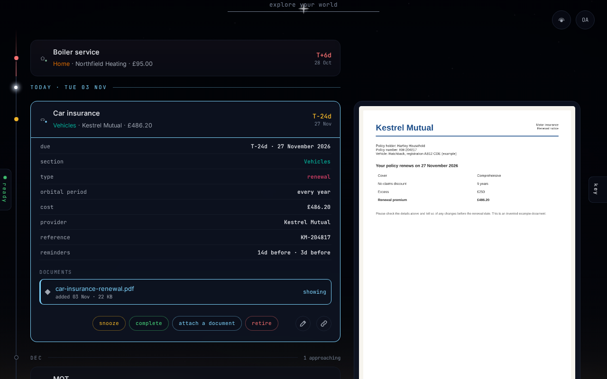
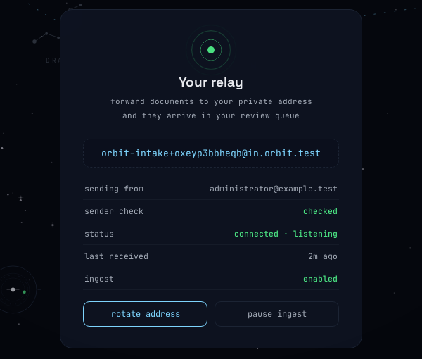
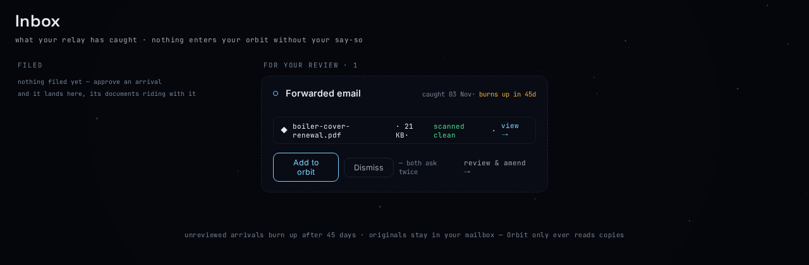
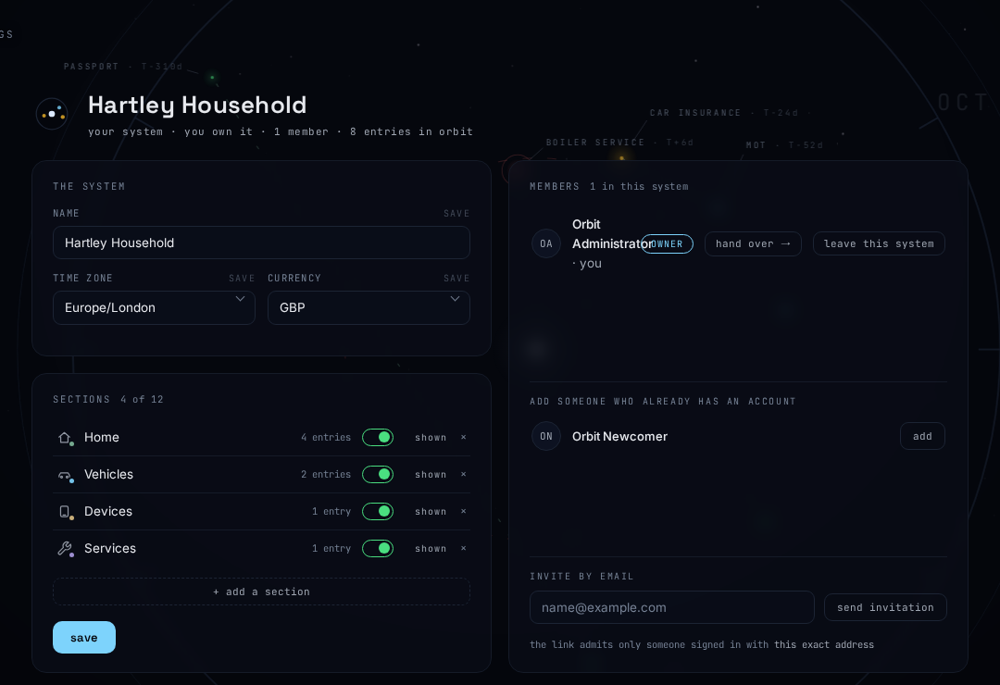

# Using Orbit

This guide is for everyone in a household who uses Orbit day to day. It walks
through the things you will want to do, in the order you are likely to meet
them. For a tour of the screens themselves, see
[What Orbit does](overview.md). For signing in, see
[Authentication](authentication.md).

The guide describes Orbit on a computer screen. On a phone the main screens
have their own layout, so some controls look different.

Orbit calls a household a **system**. You will see both words here; they mean
the same thing.

## Join or start a household

When you first sign in and you are not yet in a household, Orbit asks
**where do you belong?** You have two choices.

- **Ask to join a household that already exists.** Press **ask to join**
  beside its name. The row then says **waiting** until the household's owner
  approves or declines you.
- **Start your own.** Press **name your own system**, give it a name, choose
  its time zone and currency, and press **Create**. A new household starts
  with four sections: Home, Vehicles, Devices and Services.

If you are already signed in but in no household, your sky says
**you’re adrift**. Press one of the household labels in the sky to ask to
join it: Orbit asks **Request to join … system?**, and you press
**request to join**.

If someone invited you by email, open the link in the message. Orbit asks
you to sign in, then takes you straight into that household. The link only
works for someone signed in with the exact address it was sent to.

## Find your way around

Your home screen is your sky. Each thing you look after sits on the dial,
and the list below it shows the same things in date order:

- anything overdue first, then a **TODAY** line;
- then each coming month, with how many items are approaching;
- then, under **no date**, anything you keep without a date.

The round button with your initials opens the menu: **Inbox**,
**Settings** and **About**, the theme colours, **↻ watch the tour** and
**sign out →**. The inbox button opens your inbox and shows how many
forwarded emails are waiting for you.

On most other screens, **← YOUR SKY** takes you back home. A household
screen opened from Settings shows **← SETTINGS** instead.

## Add an item

1. On your home screen, press **create**.
2. The **Add to your orbit** drawer opens. Press **something else** to
   open the full form, or drop a document on it. You can also press
   **open the full form →**.
3. The full form opens. Type a name in **Name this entry**.
4. Under **section**, choose where the item belongs. There is no default:
   you must choose one. Sections are the item's categories.
5. Under **importance**, choose low, normal or high.
6. Fill in whatever else you know: **provider**, **reference / policy no.**,
   **key date**, **recurrence**, **cost**, **reminders** and **notes**. Press
   **key date** to pick the day from a calendar. These fields appear once you
   have typed three letters of the name or chosen a section.
7. Press **Add to orbit**. Orbit returns to your home screen with the new
   item open.

Press **cancel** to leave without saving. Once the rest of the form has
opened, Orbit asks **Discard this entry?** before throwing it away.

You can also start from the search box: type a name that matches nothing and
choose **add "…" as an item**.

An item has no type: the section is its category. Orbit works out the
schedule from the key date and the recurrence. An item with a key date is
scheduled; an item with no date is saved unscheduled, and it shows as a
suggestion.

## Set when it’s due

- **key date** is when the item is next due. Pick it from the calendar.
- **recurrence** is how often it comes round: **once**, or **every 1, 3, 6,
  12 or 24 months**. A new item starts at every 12 months.

An item with no key date is saved unscheduled and sends no repeat.

Items with no date are kept at the foot of your list under **no date** and
are not drawn on the dial.

## When Orbit says “not yet”

The **Add to orbit** button stays unavailable until the item can be saved,
and the reason is shown beside it. You may see:

- **not yet — give it a name**
- **not yet — choose a section**
- **not yet — use a dot for pence, for example 12.50**

Nothing you typed is lost while the message shows.

## Open an item

Press an item on the dial or in the list, and its drawer opens in place. It
shows when the item is **due**, its **section**,
**orbital period** (how often it repeats), **cost**, **provider**,
**reference** and **reminders**, then its **notes** and **documents**.

Along the bottom are the things you can do: **snooze**, **complete**,
**attach a document** and **retire**. At the right end, the pencil edits
the item and the chain-link button copies a link to it.

## Change an item

1. Open the item and press the pencil (**edit**).
2. Change what you need. Press **due**, **section** or
   **orbital period** to choose from a list or calendar; type straight into
   **cost**, **provider**, **reference** and **notes**.
3. Press **save**.

In **reminders**, press the chips for the days before the due date you want
to be reminded: 7, 14, 30, 60 or 90. Several can be on at once. A saved day
that is not one of these chips shows as an extra chip; press it to remove it.

Press **cancel** to stop. If you have changed something, the button first
asks **discard changes?**; press it again to throw the changes away.

## Mark it done

1. Open the item and press **complete**.
2. Check **completed on** (it starts at today; press it to pick another
   day). You can also update the **cost** and **notes**.
3. If the item repeats, Orbit shows **then** and the next due date.
4. Press **record**.

The next due date counts from the day you say it was done, not from the old
due date. An item that does not repeat, or a document, has no next date
once completed; its row then says when it was done.

## Snooze it

Press **snooze** in the item's drawer and choose a day from the
**snooze until** calendar. The day must be after today. Reminders that would
have arrived before that day are not sent. The due date itself does not
change.

## Retire or restore an item

Press **retire**, then press again to confirm. The item leaves your list and
the dial, but it is not deleted.

If you open a retired item again, for example from a link you copied, its
drawer offers **restore** to bring it back.

## Find something

Use the box below the dial on your home screen, **explore your world**. It
matches item names, sections and providers, and the names of attached
documents. Use the arrow keys to step through the results and Enter to open
one.

## Reminders

Orbit reminds everyone in the household about each item, at 9 in the
morning in the household's time zone.

- **When you add an item**, the **reminders** field starts with your first
  and final warnings: 14 days and 3 days before. Press the chips 7, 14, 30,
  60 or 90 to change them; several can be on at once. A saved day that is not
  one of these chips shows as an extra chip, which you can press to remove.
  You can see your first and final warnings in **Settings**, on the **Mail**
  card's **reminders** tab, as **first warning** and **final warning**; they cannot be changed in the
  app.
- **To change an item's reminders later**, edit the item and change
  **reminders**. An item can have up to 8 reminders, each up to 365 days
  before.
- Completing an item ends the reminders for that date; a repeating item's
  reminders start again for its next date. A retired item gets none, and a
  snoozed item gets none before the day it is snoozed until.

<!-- screenshot: settings, Mail card on the "reminders" tab with both switches on -->

### Choose how reminders reach you

Open **Settings**, find the **Mail** card and choose its **reminders** tab.

- **email reminders** turns reminder emails on or off for you.
- **browser alerts · this device** turns alerts on or off in the browser you
  are using now. Your browser asks for permission the first time. Turn it on
  in each browser where you want alerts.

Both depend on your administrator: **outbound mail** shows whether email is
set up, and browser alerts only work if your administrator has set them up.
If both switches are off, Orbit sends you nothing.

### See what was sent

The Mail card's **sent to you lately** tab (**sent lately** on a phone) lists recent reminders: which item, which
warning, and whether it went by email or browser alert. A reminder that
could not be sent says so. Press one to open its item.

## Documents

Orbit keeps PDFs and photos (JPEG or PNG) with your items. Each file is
checked for malware before it is kept, unless your administrator has turned
scanning off.

### Add a document with a new item

On the full form, drop a file on **drop a document**, or press it to choose
one. The screen splits: the form on one side and the first page of your
document on the other. Orbit stores the file as soon as you choose it, to
check it and to see whether you already hold it, but no item is made until
you press **Add to orbit**: the item and the document are then saved
together. A file you take back out, replace, or leave behind without adding
is deleted.

If your administrator has set up document reading, Orbit reads the file
and fills any empty **provider**, **reference / policy no.**, **key date**
and **cost** fields with what it found, each marked **from document**.
Check each one: press **✓ accept** to confirm it, or type over it.

Press **not this one** to take the file back out; any suggestion you have
not accepted goes with it. If Orbit refuses the file, it says why, and the
item cannot be added until you drop another file or press **remove it** to
save without one.

### Already in your orbit

If the file is byte for byte one your household already holds, the form
says **Already in your orbit** before it reads anything: which entry holds
the file and the day it was added, with a link to open it. If that entry is
due within 30 days, or overdue, it says so, in case you meant to add this
year's paper. Press **keep it anyway** to add the file as a second copy (a
quiet line keeps that in view until you save), or **not this one** to take
it back out. Only your own household's files are compared, and only exact
copies: a new scan of the same paper is a different file.

A mail-in suggestion whose attachment you already hold says so on its
receipt in the inbox, with the same link. **Add to orbit** keeps it as a
second copy; dismissing the mail drops the mail, not the copy you hold.

### Attach a document to an existing item

Open the item and press **attach a document**, then choose the file.

### Read a document

In an item's drawer, press a document under **documents**. A preview of
the page opens beside the drawer. Press the page to open the reader, where
you can turn pages, zoom with **−**, **+** and **fit**, **download** the
file, or **close**.

A file still being checked shows **Still scanning this file** until it is
ready.

### Remove or restore a document

Only the person who added a document, the household's owner, or an instance
administrator can remove or restore it. In the reader, press **remove**, then press again to confirm. Orbit keeps a
removed document for a while (the preview says until when), and
**restore** puts it back exactly as it was. After that it is gone for good.

## Forward documents by email

Every member has a private **relay** address. Forward an email with a
document attached to it, and Orbit reads it and puts it in your inbox for
review. Nothing is added to your household until you say so.

This only works if your administrator has set up Orbit's mailbox.

### Set up your relay

Open **Settings** and choose the **your relay** tab of the **Mail** card.
The tab shows your **address**; click it (tap it on a phone) to
copy it. If your administrator has paused ingest, the address stays and the
tab says collection is paused by the administrator: mail you send now
waits and is read when it resumes.

Orbit only accepts mail forwarded from the address shown as
**sending from**. If **sender check** says **not yet checked**, press
**send the check email** and open the link in that email within 24 hours,
while signed in to Orbit. This email needs your administrator to have set
up outbound mail.

On the same tab:

- **rotate address** gives you a new relay address (press twice to
  confirm);
- **pause ingest** stops Orbit collecting your forwarded mail until you
  press **resume ingest**.

### Review what arrived

Open your **Inbox**. Under **For your review**, each forwarded email shows
what Orbit read from it and its attachments.

- **Add to orbit** files it as an item, with its documents.
- **Dismiss** throws it away.
- **review & amend →** opens it on your home screen so you can correct what
  Orbit read, then **add to orbit**.

**Add to orbit** and **Dismiss** each ask you to press twice. A proposal
approved with no key date becomes an unscheduled item. An item read from a
document by mail that ends on a date, such as an expiry, happens once and has
no repeat.

Anything left unreviewed burns up after 45 days. Items you have added are
listed under **Filed**. Messages Orbit could not use are listed under
**Failed to process**, with the reason.

Forwarded items also appear on your home screen as hollow circles until you
decide. Open one to see the same choices.

## Your household

Open your household's screen by pressing the sun in the middle of your sky,
or from **Settings → Your systems**, which lists every household you belong
to.

Everyone in a household sees its name, time zone and currency, and the
**Members** list. Only the household's owner can change its settings or its
members.

### Leave a household

In **Members**, press **leave this system** on your own row, then press
again. Everything you added stays with the household.

An owner cannot leave or be removed. An owner must hand the household over
first.

### For owners: add people

In **Members**:

- **Add someone who already has an account**: press **add** beside them.
- **Invite by email**: type their address and press **send invitation**.
  Orbit emails them a link that lasts 14 days. You can **resend** or
  **withdraw** it. This needs your administrator to have set up outbound
  mail; if not, the invitation shows **not sent**.
- **Knocking on the door** lists people asking to join. Press **approve** or
  **decline**.
- To remove someone, press **remove** on their row, then press again.

### For owners: hand the household over

Press **hand over →** on your row. Choose who takes it, then press
**hand over to …** and press again to confirm. You stay a member and keep
everything you added.

### For owners: sections

The **Sections** card lists the household's sections, up to 12.

- Rename a section by typing in its name.
- Use the switch to show or hide a section. A hidden section is not offered
  when adding an item.
- Press **+ add a section** to add one.
- Press **×** to remove a section. If it still holds items, Orbit asks where
  they should go. You cannot remove the last section.
- Press **save** to keep your changes.

### For owners: name, time zone and currency

In **The system**, change the **name**, **time zone** or **currency** and
press **save** beside it. The time zone decides what "today" is for the
household and when reminders arrive.

### For owners: take a copy of the household

**The archive** card writes an encrypted file of the household to download.

1. On **take it with you**, press **write an archive →**.
2. Choose a passphrase and type it twice. Orbit never keeps it: lose it and
   the file cannot be opened.
3. Press **write the archive**, press again, then **download the file**.
   The file is kept for a day.

Entries and their documents go in the file; people never do. The
**bring one in** tab merges an archive into the household. Entries that are
already there stay out.

Orbit may first ask for your password, or send you to your identity
provider, to confirm it is you.

### For owners: delete the household

Under **The danger line**, press **request deletion →**, type the
household's name exactly, then press **request deletion** twice. Everything
in the household stops at once. You have 30 days to change your mind: ask
your administrator, who can undo it until then.
